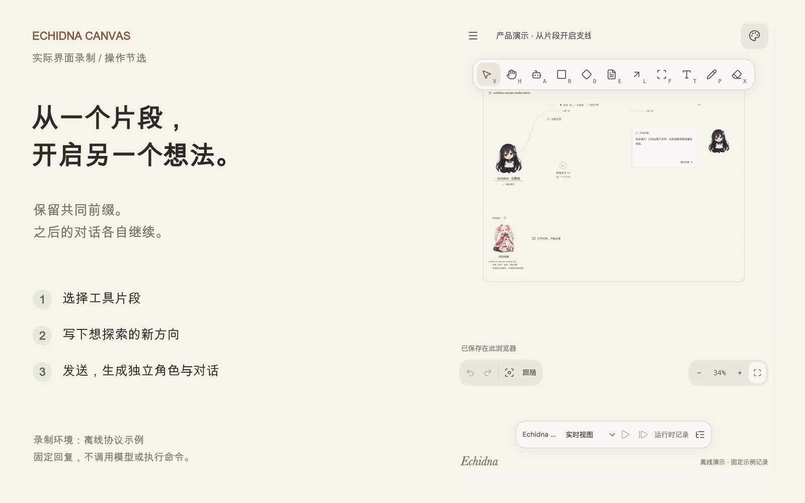
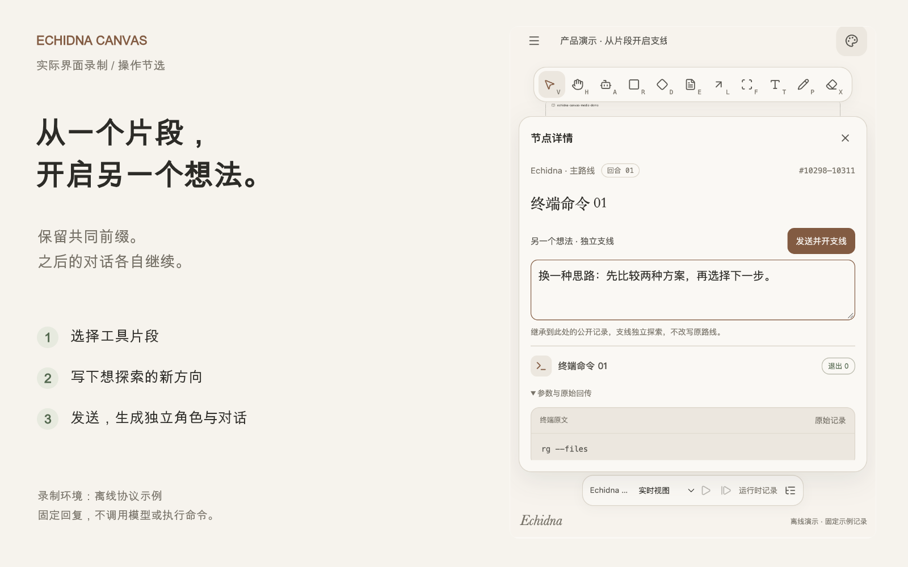
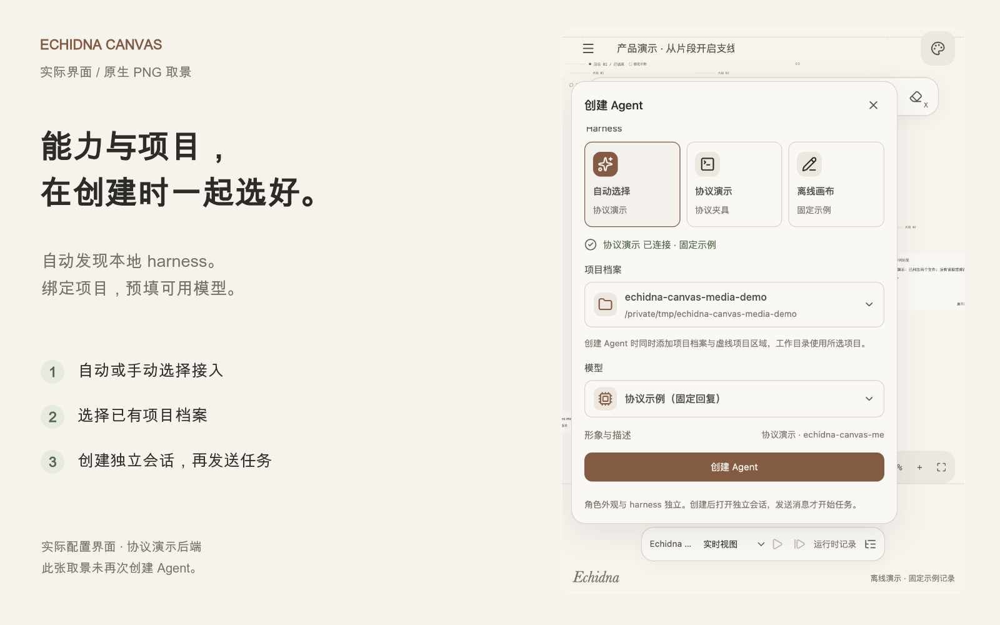
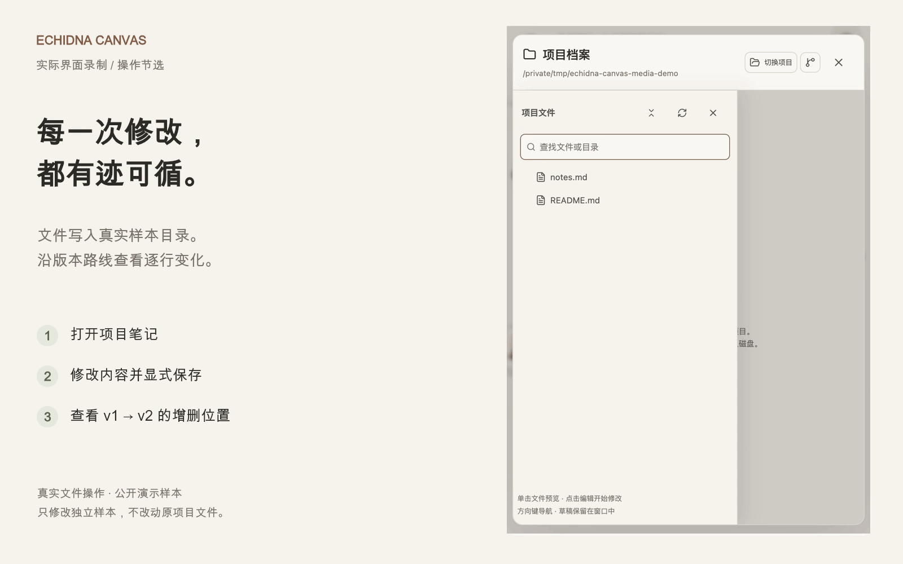
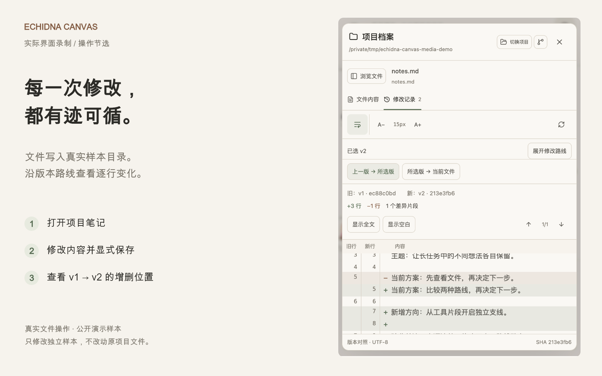

<h1 align="center">Echidna Canvas</h1>

<p align="center"><strong>让长任务看得见，让不同想法有各自的路线。</strong></p>
<p align="center">本地 Agent 画布 · Codex 真实运行时 · 片段上下文分支 · 项目档案 · MCP</p>

<p align="center">
  <a href="#功能演示">功能演示</a> ·
  <a href="#快速开始">快速开始</a> ·
  <a href="docs/USER_GUIDE.md">使用指南</a> ·
  <a href="docs/PHILOSOPHY.md">项目思想</a> ·
  <a href="docs/STATUS.md">当前状态</a>
</p>

[](docs/media/ui-branch.mp4)

<p align="center">
  <a href="docs/media/ui-branch.mp4">观看片段分支录屏</a> ·
  <a href="docs/media/ui-files.mp4">观看文件修改录屏</a> ·
  <a href="docs/media/index.html">本地媒体展示页</a> ·
  <a href="docs/media/README.md">媒体来源与说明</a>
</p>

人物是对话入口，工具与材料形成可追溯的路径。你可以检查一条命令、在片段中提出另一个想法、对照文件修改，或把独立 MCP 接入连接到需要它的 Agent。

上方为**独立演示画布的实际操作节选**：选择片段、输入想法、发送支线并打开新对话。录制使用离线协议示例，固定回复不调用模型；文件演示会实际保存公开样本。原生无损 PNG 与未加注解的录屏另行保留。

## 功能演示

### 从片段处，探索另一个想法

在一个工具回执处直接输入替代方案，开启新支线。它只继承截至该点的公开记录，原路线后来的对话不会混入。共享文件和外部状态仍是当前版本。

[](docs/media/clean/fragment-branch.png)

### 创建 Agent 时，把能力与项目一起选好

自动或手动选择已接入的 Codex，读取实际模型目录，同时绑定真实项目档案。每个 Agent 保持独立 Session；发送第一条消息才开始执行。

[](docs/media/clean/create-agent.png)

图中使用已接入的离线协议示例；切换为真实 Codex 后，模型与认证选项来自该 harness。

### 沿版本路线，看清文件改了哪里

项目档案连接真实目录。打开文件、显式保存，或选择一个历史版本查看逐行增删；遇到外部修改时保留草稿并报告冲突。

[](docs/media/ui-files.mp4)

[](docs/media/clean/file-history-diff.png)

本次独立样本实际生成 v1 → v2，显示 +3／−1 行；[查看版本连线原图](docs/media/clean/file-version-route.png)。

<details>
<summary><strong>把 MCP 作为独立能力，连接到不同项目</strong></summary>

填写已有网关的地址与认证方式，通过连线显式应用到目标 Agent。同一接入可连接多个项目，已有绑定保持指定版本。

Docker 图标代表配置的 MCP 网关，不安装 Docker 或启动 daemon。当前支持地址式 Streamable HTTP；实际工具就绪和配置绑定分别核对。

</details>

<details>
<summary><strong>方向变了，回到对话里打断或纠正</strong></summary>

在当前会话追加纠正，或保留另一条独立路线。运行中先请求打断，等待确认后再发送；已有命令和未知结果继续保留。

回合中断与 OS 后台命令终止分别记录，不能用一个状态代替另一个。回合结束后，打断按钮禁用。

</details>

所有展示图、GIF、MP4 与海报统一为 **1600×1000（8:5）**。点击静态展示图查看 **1036×1448 的原生无损 PNG**；[媒体展示页](docs/media/index.html) 可播放视频、打开原始录屏，也保留 [18 秒上下文示意动画](docs/media/context-branch.mp4)。完整步骤见 [使用指南](docs/USER_GUIDE.md)。

## 快速开始

需要 **Node.js 24+、npm**。真实模式另需本机已有 Codex；最近验证版本为 0.163.0。当前仓库为私有，需要对应 GitHub 访问权限。

**终端一：启动画布。**

```sh
git clone https://github.com/F0und-icu/echidna-canvas.git
cd echidna-canvas
npm ci
npm run dev
```

**终端二：选择一种后端。**

```sh
# 固定样例，不调用模型、不执行样例命令
npm run dev:server

# 或连接真实 Codex；两种后端只能运行一种
npm run dev:codex
```

打开 [http://127.0.0.1:4173](http://127.0.0.1:4173)，使用 Agent 画笔（A）或「Menu → Agent 连接 → 创建 Agent」。需要登录时可选择浏览器授权、设备码或 API Key；选择项目、模型，再发送第一条消息。

仅查看「Menu → 示例场景」不需要后端，场景中的委派属于离线演示。前端和本地服务分别监听 loopback 的 4173、4181 端口。

配置 Codex 路径、认证、项目目录、MCP 与数据保存位置，见 [配置说明](docs/CONFIGURATION.md)。

## 项目思想

长任务应让人能检查来源、纠正方向、保留不同想法，并回到具体的转折点。

- **路径来自实际记录。** 输入、材料、工具回执、公开决策和结果逐步生长，原文按需展开。
- **上下文有明确边界。** 从片段分支保留共同前缀，之后独立探索。
- **关系可见，事实有主。** 项目区域组织人物与档案，版本线记录文件变化，MCP 线引用已应用的配置；拖动、复制和刷新不重派发执行。

角色外观与模型能力独立。完整取舍和边界见 [项目思想](docs/PHILOSOPHY.md)。

## 当前范围

已接入 Codex app-server，支持真实对话、Markdown、终端回执、图片放大、网页主题链接、用户发起的片段分支、项目档案和独立 MCP 配置。

最近的 [真实长任务验收](docs/LONG_TASK_ACCEPTANCE_20261019.md) 使用 Codex 0.163.0 / gpt-6.1-sol，包含网页读取、程序、30 项业务测试、报告与 PNG、实际样本 MCP 调用、分支隔离及打断纠正。代码回归记录为 184 PASS，另有两项原生二进制离线集成通过。

仍有明确缺口：窄窗口全图可读性、相对产物链接和长图性能；跨进程 Resume、AI 自动委派、其他 harness、真实 Docker 与外部 MCP OAuth 全流程尚未验收。媒体演示不改变这些结论，具体证据见 [项目状态](docs/STATUS.md)。

## 开发与文档

```sh
npm test
npm run build
npm run format:check
```

浏览器测试、原生 Codex 离线集成、数据保存边界和构建体积提醒见 [配置与检查](docs/CONFIGURATION.md#开发检查)。

| 文档                                                                      | 内容                                           |
| ------------------------------------------------------------------------- | ---------------------------------------------- |
| [使用指南](docs/USER_GUIDE.md)                                            | 创建、片段分支、纠正、文件修改、MCP 与常见情况 |
| [配置说明](docs/CONFIGURATION.md)                                         | Codex 路径、认证、权限默认值、存储与开发检查   |
| [项目思想](docs/PHILOSOPHY.md)                                            | 长任务中的人参与、上下文边界与事实归属         |
| [媒体说明](docs/media/README.md) · [原始截图](docs/screenshots/README.md) | 图文取景、功能动画、来源与复现方式             |
| [架构](docs/ARCHITECTURE.md) · [交互契约](docs/INTERACTION_CONTRACT.md)   | 数据、命令、事件与来源边界                     |
| [计划](docs/DEVELOPMENT_PLAN.md) · [验收场景](docs/ACCEPTANCE.md)         | 阶段依赖、完成门槛与实际状态                   |
| [设计原则](design/DESIGN_PRINCIPLES.md) · [素材说明](docs/ASSETS.md)      | 图形语言、配色、角色及使用范围                 |

## 参考与归属

画布交互参考 [Excalidraw](https://github.com/excalidraw/excalidraw)，图形语言参考 [diagram-design](https://github.com/cathrynlavery/diagram-design)。README 展示结构参考 Excalidraw、[Flowise](https://github.com/FlowiseAI/Flowise) 与 [Continue](https://github.com/continuedev/continue) 的定位、演示、快速开始及文档分层方式，没有复用它们的媒体素材。

图标使用 Lucide；角色包含 AI 生成同人形象，来源与范围见 [素材说明](docs/ASSETS.md)。[Echidna Agent](https://github.com/F0und-icu/echidna-agent) 为后续运行时接入目标，目前未接入。本仓库暂未授予整体开源许可，也不声称第三方角色的官方授权或商业分发许可。
