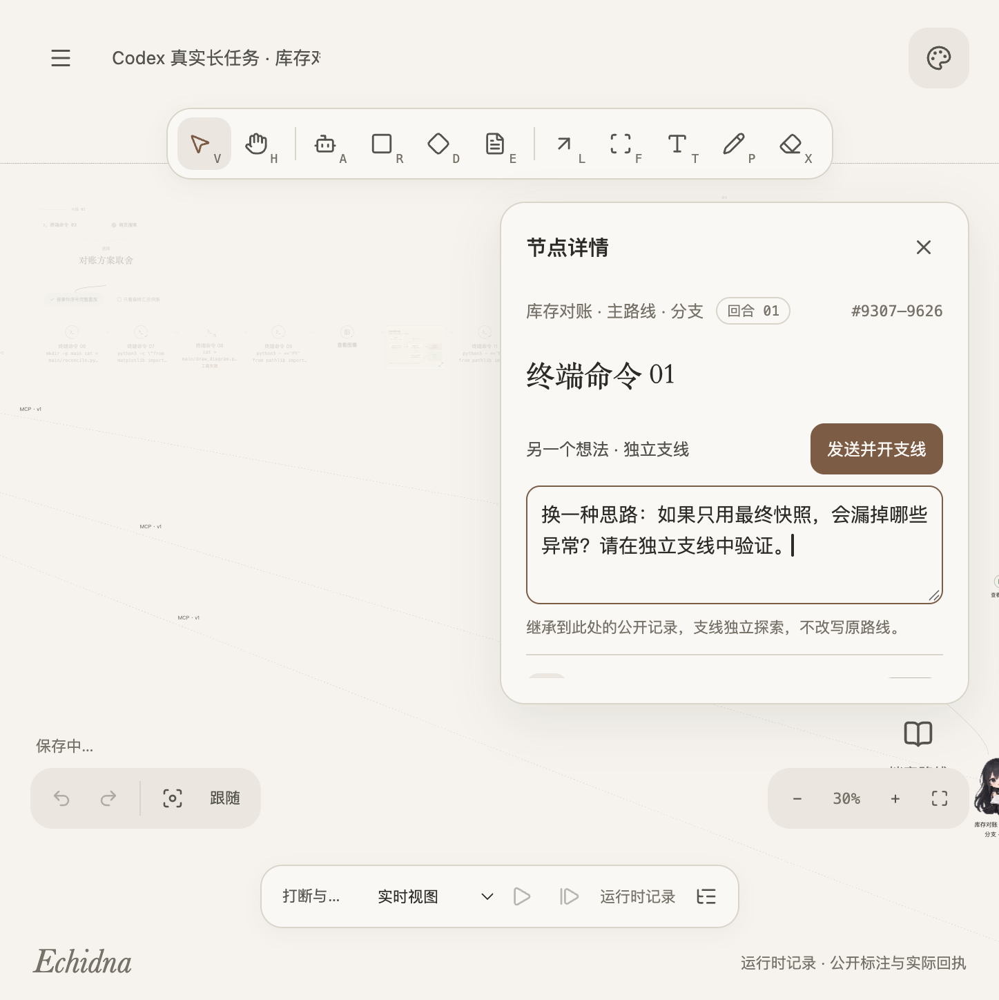

# Echidna Canvas

用一张持续生长的画布，与 Agent 对话、观察任务，并从已记录的片段探索另一个想法。

Echidna Canvas 是一个单用户、本地运行的 Web Agent 工作台。人物是对话入口，任务、工具回执、图片、网页和项目文件沿实际记录展开。执行事实与画布视图分别保存，移动、隐藏或复制图形不会重放命令。

**当前实现：P3b 真实 Agent 与任务图，以及用户追加的项目档案和 MCP 接入。** 已接入 Codex app-server；其他 harness、AI 自动委派和跨进程 Resume 尚未实现。最近一次真实长任务使用 **Codex 0.163.0 / gpt-6.1-sol**，核心执行与分支隔离已验证，长图在窄窗口中的整体可读性仍未通过。详见 [项目状态](docs/STATUS.md) 与 [2026-10-19 验收记录](docs/LONG_TASK_ACCEPTANCE_20261019.md)。

[使用指南](docs/USER_GUIDE.md) · [项目思想](docs/PHILOSOPHY.md) · [截图与来源](docs/screenshots/README.md)

[](docs/screenshots/fragment-branch.png)

实际界面：选择一个工具片段，在「另一个想法 · 独立支线」中输入。截图中的文字仅用于展示填写方式，没有发送。图片保留 Retina 原始像素的无损 PNG，点击查看原图。

## 项目思想

长任务需要人能随时看懂进展、检查来源、纠正方向，并保留另一种想法。Echidna Canvas 将这些操作放到同一张画布上：

- **让任务沿记录生长**：输入、材料、工具回执、公开决策和结果形成可回看的路径，原文按需展开。
- **让想法从具体位置分开**：从片段处创建独立对话，清楚保留共同前缀和后续分歧。
- **让能力与项目显式连接**：Agent、项目档案和 MCP 是不同对象，通过项目区域、文件版本线和配置绑定线说明关系。
- **让操作与事实各有归属**：画布负责组织视图，运行时负责执行记录；未知结果持续可见，拖动和刷新不重派发。

人物用于提供对话入口和表达已记录的状态，角色外观与模型能力独立。设计取舍和当前实现边界见 [项目思想](docs/PHILOSOPHY.md)。

## 已有能力

- **独立 Agent**：创建时选择项目和 harness，自动读取 Codex 的模型、思考强度与支持的原生配置；每个 Agent 使用独立 Session 和模型状态。
- **真实对话与任务图**：流式回复、Markdown、终端命令与输出、可追溯工具来源；图片支持放大，网页显示主题与域名并跳转原链接。
- **片段支线**：在片段处输入并发送，创建独立对话，只复用分支之前的公开记录，不继承主线后续对话。
- **打断与纠正**：运行时保留纠正草稿，请求打断并等待确认，再发送新输入；旧路线及未知结果继续保留。
- **项目档案**：真实目录浏览、文本编辑、多文件草稿、保存冲突检查、版本连线和逐行差异；角色与档案位于自适应虚线项目区域。
- **独立 MCP 节点**：配置 Docker 或通用 MCP 图标，通过连线将指定配置版本应用到不同项目的 Agent。
- **本地画布**：平移、缩放、绘图、连线、主题、新建和复制；刷新恢复视图与已持久化记录，不自动续跑。

## 快速开始

需要 **Node.js 24+、npm**。真实模式还需要本机可运行的 Codex；最近验证版本为 0.163.0。

应用实现位于 `main`。仓库为私有，需要有访问权限的 GitHub 账户。

```sh
git clone https://github.com/F0und-icu/echidna-canvas.git
cd echidna-canvas
npm ci
npm run dev
```

打开 [http://127.0.0.1:4173](http://127.0.0.1:4173)。前端通过同源代理访问本地服务；两者都只监听 loopback。

另开终端，在仓库目录选择一种后端启动：

| 模式 | 命令 | 行为 |
| --- | --- | --- |
| 离线夹具 | `npm run dev:server` | 保存自定义输入，返回固定样例；不调用模型、不执行样例 shell 命令 |
| 真实 Codex | `npm run dev:codex` | 启动应用专属 Codex app-server，发送消息后实际执行 |

两个后端共用 `127.0.0.1:4181`，切换时先停止另一个。仅查看画布内置的三个「Menu → 示例场景」不需要后端；这些场景中的协作与委派是离线演示。

可指定 Codex 路径和默认项目目录：

```sh
ECHIDNA_CANVAS_CODEX_BINARY=/absolute/path/to/codex \
ECHIDNA_CANVAS_PROJECT_DIR=/absolute/path/to/project \
npm run dev:codex
```

未指定时分别使用 PATH 中的 `codex` 和当前工作目录。每个 Agent 创建时仍可选择自己的项目目录；目录必须已存在。

## 创建 Agent 与认证

使用 **Agent 画笔（A）** 点击画布，或进入 **Menu → Agent 连接 → 创建 Agent**：

1. 选择自动连接或 Codex 图标，读取当前本地服务、账户与模型目录。
2. 未登录时，选择浏览器授权、设备码或 API Key；完成后刷新登录与模型。
3. 选择项目档案、模型与思考强度；名称自动生成，形象与描述可修改，支持的原生人格选项按模型能力显示。
4. 创建后同时出现 Agent、项目档案和项目区域；输入消息并点击发送才开始模型回合。

认证由 Codex 写入应用专属的 `~/.echidna-canvas/codex-profile`，不导入已有 CLI 或桌面应用登录。认证属于本机 harness/profile，模型配置属于各 Agent；API Key 不保存到画布。工作偏好文字目前是画布备注，不自动作为行为提示注入。

真实模式默认使用 **HTTP/SSE 模型传输、完整文件与网络访问、实时网页搜索、无需执行审批**。应用附加的 developer instructions 仅包含画布标注与来源查询工具的用法，用户消息保持原文。未接入的 harness 不显示为可用实现；连接失败会保留错误和表单。

当前每个本地服务选择一个实际 runtime。新增 harness 需要实现 [RuntimeBridge](server/runtime-port.ts)、事件 codec 与固定 composition 接入，并验证认证、模型、命令和来源语义。接口说明见 [P3a](docs/P3A_RUNTIME_CHAT.md)。

## 从片段开启另一个想法

点击任务片段，在「另一个想法 · 独立支线」输入并发送，会创建新 Agent 并启动这条支线。用户消息旁也可从发送前分支并预填原文，回复旁可从回合结束后分支。

支线只继承所选点之前的对话：片段分支使用截至该点的公开记录快照，消息边界分支使用原生上下文前缀。主线可以继续，两边后续对话互不混入。分支不会重放旧工具，但仍使用当前共享文件、外部状态和 MCP 配置，不是文件系统快照。

纠正当前方向时，在原 Agent 对话中填写草稿；运行中先请求打断，确认后再发送。回合中断与 OS 命令取消是不同事实，已有后台命令仍可能稍后返回结果。断线或未知状态不会自动触发重发。

## 项目档案与修改路线

点击画布上的碧翠丝「项目档案」打开文件窗口。创建 Agent 时绑定的项目决定实际工作目录；手动切换档案不会修改已有 Agent 的目录。同项目复用档案，不同项目保留各自文件和版本路线。

支持目录树、筛选、默认只读预览、字体与换行调整、Markdown 阅读、多文件草稿和显式保存（`⌘/Ctrl S`）。可编辑不超过 1 MiB 的 UTF-8 文本。保存会写入真实文件，并检查打开时的 SHA256；遇到外部修改时保留草稿并报告冲突，关闭未保存内容时提供返回编辑或放弃。

画布中的「档案角色 → 文件 → 版本」展示已留档的修改路线，点击版本查看内容和逐行增删差异。实线表示手动保存，虚线表示再次读取时观察到变化；拖动档案角色会一起移动路线。记录从首次读取开始，不推测此前版本、修改者或未记录分支。

常见凭据、内部记录、依赖目录及符号链接不开放给这个文件浏览入口；这不改变 Codex 的文件执行权限。当前没有文件新建／删除、Git 历史导入、实时监视、多进程写入锁或跨资源事务。文件正文和版本不写入画布导出。

## MCP 接入

从 **Menu → 接入与 MCP** 添加独立图标，填写已有的 **HTTP(S) Streamable HTTP** 地址。支持无需认证、Bearer、API Key Header 和原生 MCP OAuth 配置。Docker 图标代表指定的 MCP 网关，不会安装 Docker 或启动 daemon。

1. 将 MCP 图标放到画布，用连线工具（L）连接 Agent。
2. 在面板明确确认应用，成功绑定后显示配置版本线。
3. 读取实际工具目录，核对认证与就绪状态。

同一节点可连接多个项目的 Agent。修改接入会生成新版本，已有绑定不自动更新；静态密钥仅由本地服务保存在 `~/.echidna-canvas/mcp-credentials`。

应用配置要求 Agent 已知空闲，保留对话历史并建立新的底层 Codex Session，不启动模型回合或重放工具。当前没有 stdio 安装器；真实模型调用本地样本 MCP 已验证，真实 Docker 操作和外部 MCP OAuth 全流程尚未验收。

## 数据保存

| 位置 | 内容 |
| --- | --- |
| 浏览器 IndexedDB | 画布视图、草稿与可见记录；旧 localStorage 数据可迁移 |
| `.echidna-canvas/runtime.sqlite` | 离线夹具运行记录 |
| `.echidna-canvas/codex.sqlite` | 真实模式的命令、事件和运行时来源 |
| `.echidna-canvas/files.sqlite` | 按项目隔离的文件历史与快照正文 |
| `.echidna-canvas/mcp.sqlite` | MCP 公开配置与不可变版本元数据 |
| `~/.echidna-canvas/codex-profile` | Codex 管理的产品专属配置与认证 |
| `~/.echidna-canvas/mcp-credentials` | MCP 静态凭据 |

服务数据保存在启动目录下，已加入 Git 忽略；凭据与画布文档、导出和配置元数据分离。浏览器刷新会补齐记录；服务重启保留历史，但目前不能 Resume 旧真实会话，也不会自动续跑或把未知结果改成成功。

## 开发与检查

```sh
npm test
npm run build
npm run format:check
```

`build` 包含 TypeScript 检查；也可单独运行 `npm run typecheck`。生产构建可用 `npm run preview` 在 [127.0.0.1:4174](http://127.0.0.1:4174) 本地预览，后端仍需另行启动。

浏览器测试使用离线夹具。运行前停止真实模式后端，避免复用相同端口的真实服务：

```sh
npx playwright install chromium
npm run test:e2e
```

可选的实际 Codex 二进制离线集成：

```sh
ECHIDNA_CANVAS_TEST_CODEX_BINARY=/absolute/path/to/codex \
npx vitest run tests/integration/codex-native-fork.test.ts tests/integration/codex-native-mcp.test.ts
```

这两项测试使用独立空 profile、loopback 固定模型与样本 MCP，不读取账户或发送远程模型请求。

最近验收：默认回归 **184 PASS / 2 项可选测试跳过**；Codex 0.163.0 的上述两项另行通过；构建、格式与空白检查通过。真实长任务包含网页读取、程序、30 项测试、报告、程序绘制 PNG、MCP 调用、两层片段分支及打断纠正，另有独立 12 项业务核对和刷新不重派发检查。

仍有明确限制：窄窗口全图过散且文字过小、相对产物链接尚未直接打开项目文件、长图性能未完整验收；构建保留主包约 659 kB、按需编辑器约 775 kB 的体积警告。本次没有运行完整 Playwright 套件，实屏检查与已知失败见 [长任务验收记录](docs/LONG_TASK_ACCEPTANCE_20261019.md)。不据此声称完整产品、AI 委派、跨进程恢复或原生图像生成已验收。

## 项目结构与文档

```text
web/          React 画布、对话、档案、MCP 与记录展示
contracts/    命令、事件、文件与 MCP 的边界契约
server/       本地 HTTP/SSE、SQLite、运行时桥接与 Codex 适配
tests/        单元、集成、故障夹具和浏览器场景
design/       设计原则、原型、角色素材与来源清单
docs/         架构、阶段计划、状态和验收记录
```

| 文档 | 用途 |
| --- | --- |
| [使用指南](docs/USER_GUIDE.md) | 从启动到片段分支、纠正、文件修改和 MCP 的操作步骤与截图 |
| [项目思想](docs/PHILOSOPHY.md) | 长任务、人参与、上下文分支、空间关系与事实边界 |
| [截图与来源](docs/screenshots/README.md) | 无损原图、内容说明和捕获方式 |
| [当前状态](docs/STATUS.md) | 实际完成范围、验证结果与限制 |
| [开发计划](docs/DEVELOPMENT_PLAN.md) | 阶段依赖、交付物与验收门槛 |
| [架构](docs/ARCHITECTURE.md) · [交互契约](docs/INTERACTION_CONTRACT.md) | 数据归属、命令、事件和来源边界 |
| [验收场景](docs/ACCEPTANCE.md) | 从离线设计到真实执行的检查项 |
| [P1 离线画布](docs/P1_OFFLINE_CANVAS.md) · [P2 桥接](docs/P2_CODEX_BRIDGE.md) | 视图、投影、持久化与协议夹具 |
| [P3a 运行时](docs/P3A_RUNTIME_CHAT.md) · [P3b 任务图](docs/P3B_CANVAS_GUIDANCE.md) | 真实进程、标注工具、上下文分支和接入边界 |
| [设计原则](design/DESIGN_PRINCIPLES.md) · [素材说明](docs/ASSETS.md) | 配色、角色、来源与使用范围 |

保留的 P0 设计原型可用 Python 3.10+ 单独预览：`python3 scripts/preview.py --port 4180`。它与当前应用是两个独立入口。

快捷键：`V` 选择、`H` / 空格漫游、`A` 创建 Agent、`R/D/E/F/T/P` 绘图、`L` 连线、`X` 橡皮、`⌘/Ctrl Z` 撤销草稿。滚轮平移，`⌘/Ctrl + 滚轮` 缩放。

## 参考与归属

- [Excalidraw](https://excalidraw.com/)：白板交互参考。
- [diagram-design](https://github.com/cathrynlavery/diagram-design)：图形与排版参考。
- [Echidna Agent](https://github.com/F0und-icu/echidna-agent)：后续运行时接入目标，目前未接入。

图标使用 Lucide；角色素材包含 AI 生成的同人形象，提示词、哈希和裁切坐标见 [素材清单](design/assets/manifest.json)，归属与使用范围见 [素材说明](docs/ASSETS.md)。不声称官方授权或已获得商业分发许可。本仓库暂未授予整体开源许可。
