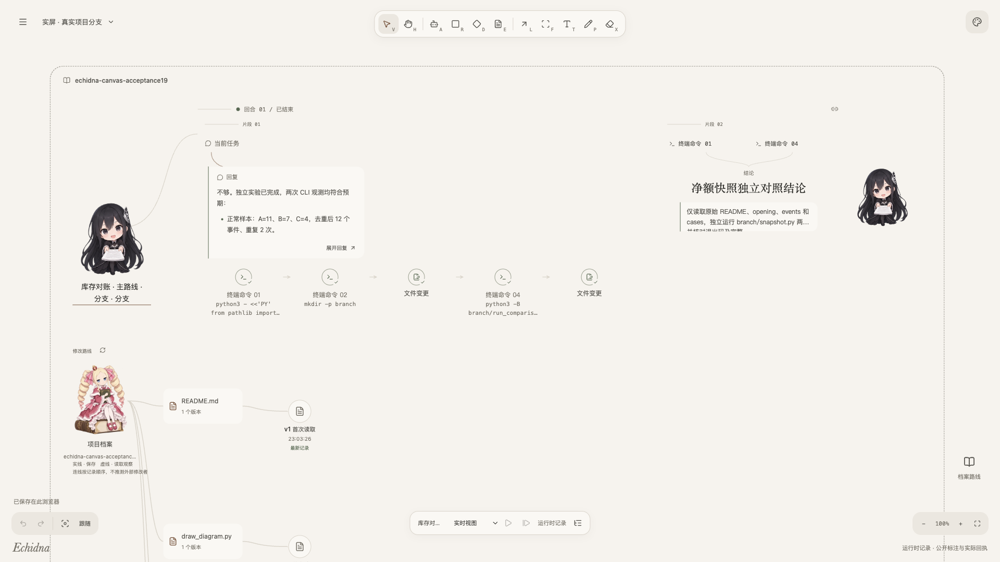
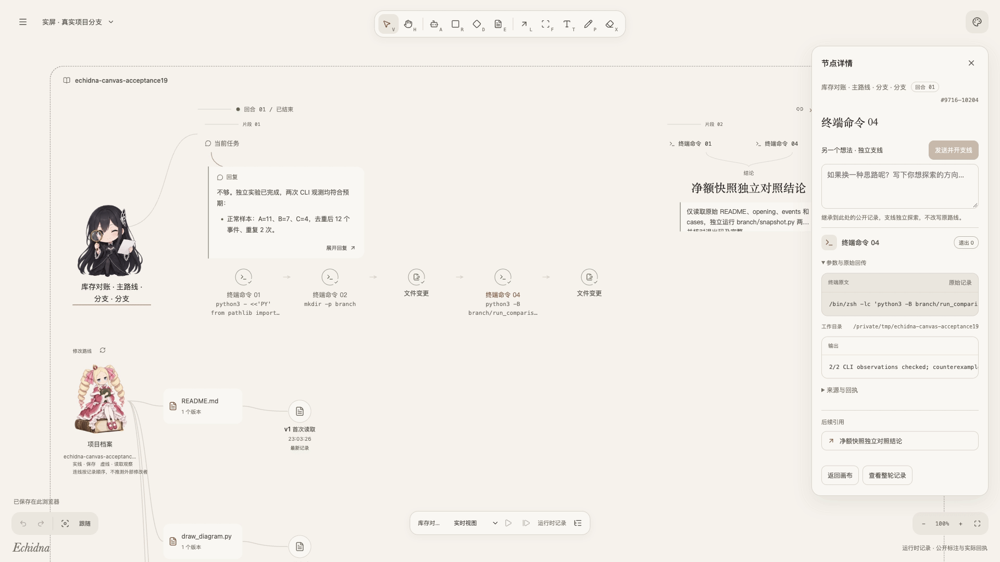
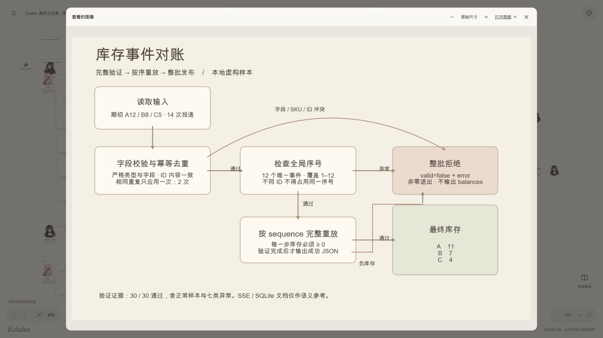

<h1 align="center">Echidna Canvas</h1>

<p align="center"><strong>让长任务看得见，让不同想法有各自的路线。</strong></p>
<p align="center">本地 Agent 画布 · Codex 真实运行时 · 片段上下文分支 · 项目档案 · MCP</p>

<p align="center">
  <a href="#功能演示">功能演示</a> ·
  <a href="#快速开始">快速开始</a> ·
  <a href="docs/USER_GUIDE.md">使用指南</a> ·
  <a href="docs/PHILOSOPHY.md">项目思想</a> ·
  <a href="docs/CONFIGURATION.md">配置说明</a>
</p>



<p align="center">
  <a href="docs/media/project/project-tour.mp4">观看真实项目记录</a> ·
  <a href="docs/media/project/project-files.mp4">观看文件与版本记录</a> ·
  <a href="docs/media/index.html">本地媒体展示页</a> ·
  <a href="docs/media/README.md">媒体来源与说明</a>
</p>

人物是对话入口，工具与材料形成可追溯的路径。你可以检查一条命令、在片段中提出另一个想法、对照文件修改，或把独立 MCP 接入连接到需要它的 Agent。

截图与视频直接来自项目中的实际界面，统一为 **1920×1080**，没有说明侧栏、拼贴或画面裁切。演示展示已完成的真实 Codex 长任务、分支、回执、报告与图片，录制时没有重新执行任务。

## 功能演示

### 从片段处，探索另一个想法

在一个工具回执处直接输入替代方案，开启新支线。它只继承截至该点的公开记录，原路线后来的对话不会混入。共享文件和外部状态仍是当前版本。

[](docs/media/project/project-tour.mp4)

录屏从画布进入真实命令回执，沿引用查看结论，再打开已经完成的独立分支对话。它展示已有任务的阅读过程；创建支线的操作步骤见 [使用指南](docs/USER_GUIDE.md#4-从中间片段开启不同想法)。

<details>
<summary>查看完整界面的命令与分支截图</summary>


</details>

### 创建 Agent 时，把能力与项目一起选好

自动或手动选择已接入的 Codex，读取实际模型目录，同时绑定真实项目档案。每个 Agent 保持独立 Session；发送第一条消息才开始执行。


截图来自已连接的 Codex 和实际模型目录，展示可用配置。

### 沿版本路线，看清文件改了哪里

项目档案连接真实目录。打开文件、显式保存，或选择一个历史版本查看逐行增删；遇到外部修改时保留草稿并报告冲突。


[文件录屏](docs/media/project/project-files.mp4) 展示打开真实任务报告、切换项目和选择既有版本；上图为手动保存历史的 v3 → v4，显示 +3／−2 行。[查看版本连线](docs/media/project/file-history.png)。

### 在任务记录里，直接查看实际产物



图中流程图由此前 Codex 任务编程生成，通过实际工具记录打开。[观看图片预览操作](docs/media/project/project-image.mp4)，或 [查看任务报告的阅读界面](docs/media/project/project-report.png)。

<details>
<summary><strong>把 MCP 作为独立能力，连接到不同项目</strong></summary>

填写已有网关的地址与认证方式，通过连线显式应用到目标 Agent。同一接入可连接多个项目，已有绑定保持指定版本。

Docker 图标代表配置的 MCP 网关，不安装 Docker 或启动 daemon。当前支持地址式 Streamable HTTP；实际工具就绪和配置绑定分别核对。

</details>

<details>
<summary><strong>方向变了，回到对话里打断或纠正</strong></summary>

在当前会话追加纠正，或保留另一条独立路线。运行中先请求打断，等待确认后再发送；已有命令和未知结果继续保留。

回合中断与 OS 后台命令终止分别记录，不能用一个状态代替另一个。回合结束后，打断按钮禁用。

</details>

PNG 保留原始截图像素，视频保留完整应用画面；长记录通过应用自身的滚动与缩放阅读。[媒体展示页](docs/media/index.html) 提供全部截图与视频，[媒体说明](docs/media/README.md) 记录来源及拍摄范围。

## 快速开始

需要 **Node.js 24+、npm**。真实模式另需本机已有 Codex，已验证版本为 0.163.0。

**终端一：启动画布。**

```sh
git clone https://github.com/F0und-icu/echidna-canvas.git
cd echidna-canvas
npm ci
npm run dev
```

**终端二：选择一种后端。**

```sh
# 固定样例，不调用模型、不执行样例命令
npm run dev:server

# 或连接真实 Codex；两种后端只能运行一种
npm run dev:codex
```

打开 [http://127.0.0.1:4173](http://127.0.0.1:4173)，使用 Agent 画笔（A）或「Menu → Agent 连接 → 创建 Agent」。需要登录时可选择浏览器授权、设备码或 API Key；选择项目、模型，再发送第一条消息。

仅查看「Menu → 示例场景」不需要后端，场景中的委派属于离线演示。前端和本地服务分别监听 loopback 的 4173、4181 端口。

配置 Codex 路径、认证、项目目录、MCP 与数据保存位置，见 [配置说明](docs/CONFIGURATION.md)。

## 项目思想

长任务应让人能检查来源、纠正方向、保留不同想法，并回到具体的转折点。

- **路径来自实际记录。** 输入、材料、工具回执、公开决策和结果逐步生长，原文按需展开。
- **上下文有明确边界。** 从片段分支保留共同前缀，之后独立探索。
- **关系可见，事实有主。** 项目区域组织人物与档案，版本线记录文件变化，MCP 线引用已应用的配置；拖动、复制和刷新不重派发执行。

角色外观与模型能力独立。完整取舍和边界见 [项目思想](docs/PHILOSOPHY.md)。

## 当前范围

已接入 Codex app-server，支持真实对话、Markdown、终端回执、图片放大、网页主题链接、用户发起的片段分支、项目档案和独立 MCP 配置。

窄窗口全图可读性、相对产物链接和长图性能仍有限制。暂不支持跨进程 Resume、AI 自动委派及其他 harness；真实 Docker 和外部 MCP OAuth 全流程尚未验证。

## 使用文档

| 文档                                                                 | 内容                                           |
| -------------------------------------------------------------------- | ---------------------------------------------- |
| [使用指南](docs/USER_GUIDE.md)                                       | 创建、片段分支、纠正、文件修改、MCP 与常见情况 |
| [配置说明](docs/CONFIGURATION.md)                                    | Codex 路径、认证、默认行为与数据保存           |
| [项目思想](docs/PHILOSOPHY.md)                                       | 长任务中的人参与、上下文边界与事实归属         |
| [项目实屏](docs/media/index.html) · [媒体说明](docs/media/README.md) | 完整项目截图、视频及演示范围                   |
| [素材说明](docs/ASSETS.md)                                           | 角色、图标来源与使用范围                       |

## 参考与归属

画布交互参考 [Excalidraw](https://github.com/excalidraw/excalidraw)，图形语言参考 [diagram-design](https://github.com/cathrynlavery/diagram-design)。

图标使用 Lucide；角色包含 AI 生成同人形象，来源与范围见 [素材说明](docs/ASSETS.md)。本仓库暂未授予整体开源许可，也不声称第三方角色的官方授权或商业分发许可。
