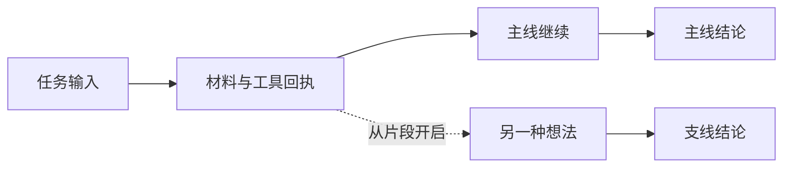

# 项目思想

Echidna Canvas 希望让人能够参与 Agent 的长任务：看懂当前进展，在一个具体片段提出问题，保留替代方案，并核对最终产物的来源。画布让这些关系留在同一处，方便来回观察和继续工作。

## 让任务成为可以回看的路径

长任务包含多次输入、材料读取、命令执行、公开决策、结果和纠正。把这些实际记录放到空间里，用户可以沿路径找到「这一步用了什么」「哪个结果改变了后续方向」「这个结论引用了哪份材料」。

画面优先显示角色、图形和连线，长文本、参数和原始输出按需展开。暖米白、九色配色和轻量悬浮工具用于保持长时间阅读的空间感。人物动作表达已记录事件的查看、等待、执行或交付状态；模型未返回的内部思维不进入事实图。

## 从具体片段保留另一个想法

人与 Agent 的合作经常会出现「如果从这里换一种方案呢」。片段处的对话入口使这个问题有明确起点：新支线复用共同前缀，之后独立探索，主线仍可继续。

图示表达对话关系。当前片段分支采用所选点之前的公开记录快照，消息边界分支使用原生前缀；两边后续对话隔离。共享目录、文件、MCP 与外部状态仍是当前状态，未实现文件系统的历史回滚。当前分支由用户发起，AI 自动创建和委派后续阶段再做。

## 区分纠正与探索

纠正是在当前会话追加新的方向；需要停止当前回合时，用户请求打断并等待运行时确认。探索则从明确位置创建独立上下文，保留不同想法的后续过程。

旧记录始终保留，失败和未知结果也可见。新的复验成功可以提供新证据，但不会把原来没有确认的执行改写为成功。回合中断与后台 OS 命令终止分别记录。

## 把能力与项目的关系画出来

一个 Agent 有独立 Session 和模型设置；一个项目档案对应真实目录与已留档文件版本；一个 MCP 节点对应版本化的工具接入。它们分别拥有自己的状态。

项目虚线区域组织同一目录下的角色与档案，文件版本线说明已经观察到的修改路线，MCP 绑定线说明某个 Agent 实际应用了哪个配置版本。同一接入可以被不同项目的 Agent 使用，修改接入不会静默替换已有绑定。

角色外观可以独立替换；模型、认证和工具能力来自实际 harness。当前只接入 Codex，其他角色图像不表示已有其他运行时。Docker 图标表示配置的网关，实际操作能力取决于该网关提供的工具。

## 让事实与视图分别拥有自己的生命周期

运行时与本地服务保存命令、执行事件、回执和来源；画布保存位置、缩放、可见内容和历史引用。拖动、复制、隐藏或刷新只改变视图，不派发执行。

断线后先对齐持久化事实。未知状态持续可见，同一个命令身份用于核对已发生的请求，避免在没有确认结果时重放工具。图上的完成状态必须有实际回执支持。

## 本地优先，逐步证明能力

当前应用面向单用户，只监听本机地址。认证由产品自己的 Codex profile 或本地接入凭据目录管理；画布和导出不持有密钥。服务数据、浏览器视图和文件内容各有保存边界。

验收同时关注实际执行、来源、分支隔离、文件与工具副作用、刷新行为和视觉可读性。离线夹具、真实二进制连接本地样本、远程模型任务及实屏检查分别记录。核心执行通过也会保留未通过的视觉结论。

当前已验证真实 Codex 长任务、片段支线、打断纠正、项目编辑和本地样本 MCP 调用。窄窗口全图可读性、相对产物链接、跨进程 Resume、自动委派、真实 Docker 与外部 OAuth 全流程仍有明确缺口。实际状态见 [STATUS](STATUS.md)，设计细节见 [设计原则](../design/DESIGN_PRINCIPLES.md)。
