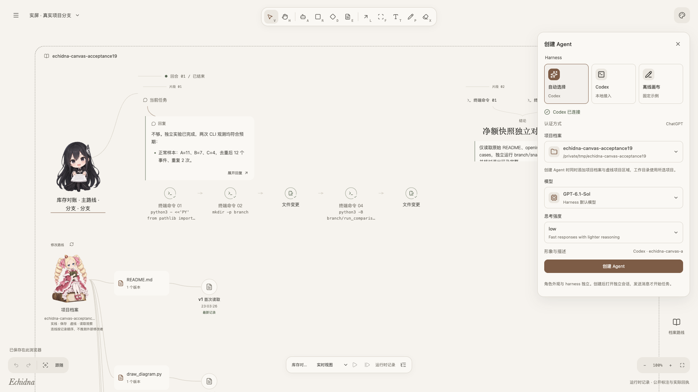
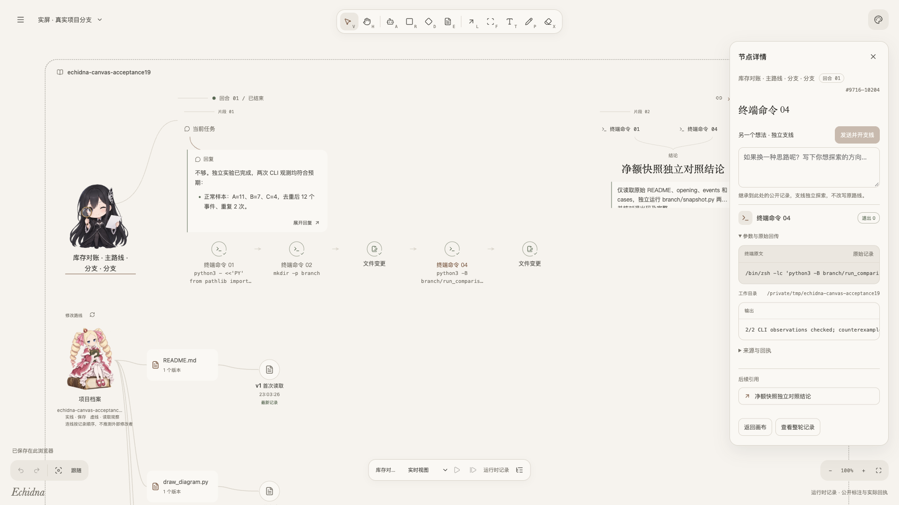
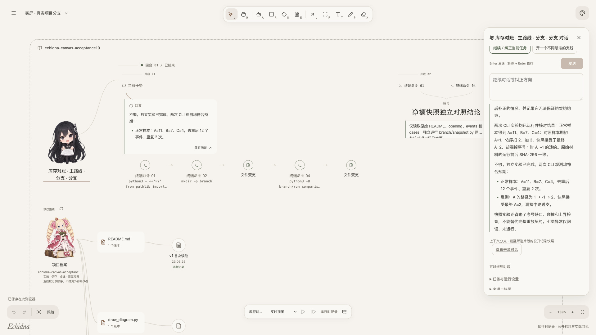
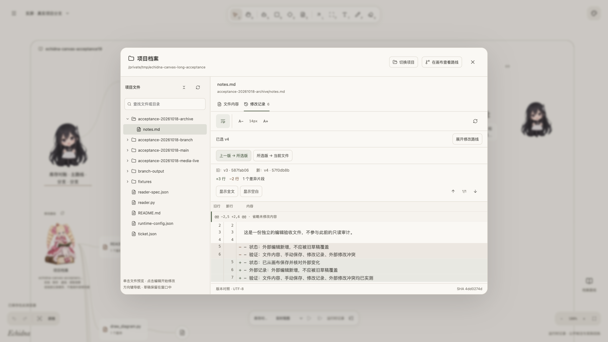

# 使用指南

先启动前端，再选择离线示例或真实 Codex 后端；完整安装命令见 [README](../README.md#快速开始)。截图来自实际应用，任务使用公开虚构样本，点击图片可以查看原始像素的无损 PNG。

初次了解功能，可先看 [真实项目记录浏览](media/project/project-tour.mp4)、[文件与版本浏览](media/project/project-files.mp4) 或 [全部实屏](media/index.html)。新素材为完整 1920×1080 应用界面，读取已有真实 Codex 任务与实际文件历史；拍摄没有重新执行任务。详细参数与保存位置见 [配置说明](CONFIGURATION.md)。

## 1. 启动与第一次体验

```sh
npm ci
npm run dev
```

打开 [127.0.0.1:4173](http://127.0.0.1:4173)。另开终端，在仓库目录运行其中一种后端：

```sh
# 固定回复、无模型调用的协议夹具
npm run dev:server
```

```sh
# 本机已有 Codex 时，连接真实运行时
npm run dev:codex
```

两种后端共用 4181 端口，切换前停止另一种。前端页面可独立打开「Menu → 示例场景」体验图形和事件回放；示例中的委派行为属于离线演示。真实任务需要创建运行时 Agent 并发送消息。

## 2. 创建 Agent，同时绑定项目档案

1. 使用顶部 Agent 画笔（`A`）点击画布落点，或打开「Menu → Agent 连接 → 创建 Agent」。
2. 选择「自动选择」或 Codex。界面自动连接服务并读取当前账户、模型及支持的配置。
3. 未登录时展开认证方式，选择浏览器授权、设备码或 API Key，完成后刷新账户与模型。应用使用独立 Codex profile。
4. 选择项目档案：使用已登记项目，或填写一个已经存在的本地绝对目录。该目录成为此 Agent 的实际工作目录。
5. 选择模型和思考强度；名称会自动生成，形象与描述可展开修改。确认创建后，人物和项目档案同时进入项目区域。
6. 点击人物打开对话，输入任务并点击「发送」。`Enter` 发送，`Shift + Enter` 换行。创建空会话本身不启动模型回合。

[](media/project/create-agent.png)

截图使用已连接的真实 Codex，配置按实际模型目录生成；本次取景未创建会话。角色形象可独立选择，外观不会增加运行时能力。当前可用的真实 harness 为 Codex；离线画布返回固定示例，不理解自定义问题。

## 3. 阅读任务、命令和来源

任务沿人物右侧按实际事件展开。点击输入、工具、回复或公开标注，可查看该节点的详细内容。终端详情保留命令原文、工作目录、输出与已返回的退出信息；「来源与回执」用于核对对应记录。

图片出现在实际记录的媒体预览中，点击可放大；网页以主题和域名卡片展示，点击打开原链接。回合上的「图片与网页」入口汇总相关记录。路径中的图形位置和角色动作属于视图，执行状态以返回记录为准。

阅读长任务时可用滚轮漫游、`⌘/Ctrl + 滚轮` 缩放，或点击「聚焦当前 Agent」恢复阅读倍率。「显示全部」适合查看关系，细节仍需局部放大；当前窄窗口全图可读性仍有局限。

## 4. 从中间片段开启不同想法

1. 选择希望作为起点的工具或任务片段。
2. 在节点详情的「另一个想法 · 独立支线」输入问题或替代方案。
3. 点击「发送并开支线」。应用创建独立 Agent，并发送这条新输入。
4. 在新角色的对话里继续探索；原路线可继续，两边后续对话独立保存。

[](media/project/terminal.png)

截图展示实际工具节点的支线入口，没有填写或发送新消息。[记录浏览视频](media/project/project-tour.mp4) 随后查看了此前已经完成的独立分支及其结果。消息旁还提供「从此消息发送前分支」和「从此回复后分支」：前者预填原消息，后者使用已结束回合的前缀。

片段分支继承截至所选点的公开记录快照，不继承主线后来的对话。它会使用当前项目文件和工具配置，文件与外部状态不会回到历史时刻；旧工具不会因为分支而重放。

## 5. 纠正当前任务与打断

继续同一方向时，在人物对话中选择「继续／纠正当前任务」。需要改变运行中的任务，可先填写纠正草稿，再点击「打断当前任务」；等待原生中断确认后发送纠正。

[](media/project/branch-result.png)

截图中的回合已经结束，所以打断按钮禁用。「开一个不同想法的支线」会使用界面指定的分支点；希望精确选择中间位置时，使用上一节的片段入口。

「中断待确认」「回合已中断」和「工具结果待核对」表达不同事实。回合中断不保证 OS 后台命令已经停止；已有命令仍可能稍后返回。断线时先重新连接并核对同一请求，应用不会自动重发旧命令。

## 6. 查看文件、编辑和逐行差异

1. 点击碧翠丝「项目档案」，或从主菜单打开档案窗口；先核对顶部的实际目录。可通过「切换项目」选择其他已存在的目录。
2. 展开目录并选中文件。默认只读；Markdown 可阅读或查看源码，字号和自动换行可调整。
3. 点击「编辑文件」后修改内容，再点击「保存修改」或按 `⌘/Ctrl S`。保存会写入真实文件，窗口内的未保存草稿尚未写入磁盘。
4. 打开「修改记录」，展开修改路线选择版本，然后查看「上一版 → 所选版」或「所选版 → 当前文件／当前草稿」。新增、删除和行号分别显示，可跳转差异、显示全文或空白。
5. 点击「在画布查看路线」返回档案角色与版本连线；画布中的版本节点也能直接打开对应记录。

[](media/project/file-diff.png)

截图选择既有文件的 v4 与 v3 对比，实际差异为 +3／−2 行；内容区域可独立滚动。[文件录屏](media/project/project-files.mp4) 展示阅读任务报告、切换项目与选择历史版本，[版本路线原图](media/project/file-history.png) 展示读取与保存的连接。本次没有修改文件；实线表示手动保存，虚线表示读取时观察到外部变化。

保存遇到外部变更会报告冲突并保留草稿，读取最新磁盘内容后可继续对照。关闭或切换项目时会检查未保存草稿。版本从首次读取开始积累，当前不导入 Git 历史；文件浏览入口只支持不超过 1 MiB 的 UTF-8 文本。

## 7. 给不同 Agent 连接 MCP

1. 打开「Menu → 接入与 MCP」，选择 Docker 或通用 MCP 图标。
2. 填写已有 Streamable HTTP 网关地址，选择无需认证、Bearer、API Key Header 或 MCP OAuth。凭据由本地服务持有。
3. 创建并放到画布。使用连线工具（`L`）连接目标 Agent，在面板确认应用；也可在接入详情选择 Agent。
4. 读取实际工具目录，核对工具就绪与认证状态。同一图标可分别绑定不同项目的多个 Agent。

接入详情中的认证选项及绑定列表可按需展开。配置修改产生新版本，旧绑定保持原版，需要显式重新应用；应用配置时 Agent 必须已知空闲，底层 Session 会切换并保留原有历史。Docker 图标表示你配置的网关，应用不会安装或启动 Docker。

## 8. 保存、退出和再次打开

画布、主题和对话草稿保存在当前浏览器；命令、事件、文件历史及 MCP 元数据由本地 SQLite 保存。复制画布会复用执行历史引用，不创建新执行。

刷新页面会补齐已持久化记录，不会启动新回合。服务进程重启后可查看旧记录，但目前不能 Resume 旧真实会话；未知结果仍需核对。文件窗口草稿只在窗口内存中，关闭时明确放弃后不会保留。

## 9. 删除与移除

打开「Menu → 管理画布内容」可整理当前画布，也可使用角色详情右上角和档案路线上的垃圾桶按钮。选中手工图形或 Agent 后，可按 `Delete`／`Backspace`，或点击左下工具栏的垃圾桶。橡皮工具（`X`）使用同一套删除规则：点击手工内容直接回收，点击 Agent、档案角色或 MCP 图标时先确认移除。

| 内容                               | 操作范围                                                                                                        |
| ---------------------------------- | --------------------------------------------------------------------------------------------------------------- |
| 手工图形、批注、自由笔迹、草稿连线 | 删除选中内容，连接到被删图形的草稿线同时删除；可用 `⌘/Ctrl Z` 撤销                                              |
| Agent 角色及其任务路径             | 确认后只从当前画布移除，独立支线保留；不会停止任务，对话和输入草稿保留                                          |
| 项目档案角色及版本路线             | 只从当前画布移除，不删除磁盘文件、版本记录或改变 Agent 工作目录                                                 |
| MCP 图标和可见绑定线               | 只从当前画布移除，不删除配置、认证或解除真实绑定                                                                |
| 整张画布                           | 在「画布 → 删除当前画布」确认删除，包含该画布的图形与布局；其他画布和任务历史保留，最后一张删除后打开新空白画布 |

删除和移除的内容进入「Menu → 回收站」的临时目录，随工作区保存在当前浏览器的 IndexedDB 中，刷新后仍可恢复，不移动磁盘上的真实项目目录。恢复对象放回当前画布，整张画布恢复为原画布；同一图形已存在时保留当前版本，连线的端点缺失时先恢复端点。回收记录不会自动清空，清除浏览器数据会同时清除这些记录。

已有 Agent、项目档案和 MCP 也可在「管理画布内容」中重新放回；恢复现有对象不创建任务、不重放命令。回收站保留删除时的视图和草稿，不复制执行事实或认证。

对话消息、任务片段、工具回执、事实连线、文件版本及真实项目文件不提供删除入口。需要停止任务请使用对话中的打断；需要断开工具请在 MCP 配置中解绑。编辑器、输入框和弹窗中的删除键只作用于各自内容。

## 常见情况

| 情况                       | 操作或含义                                                      |
| -------------------------- | --------------------------------------------------------------- |
| 页面可打开，但没有模型目录 | 启动后端，检查 Codex 可执行文件路径，再重新核对连接与认证       |
| 离线角色总返回同样内容     | 当前是固定回复示例；真实回答需切换到 Codex 后端并创建真实 Agent |
| 创建按钮不可用             | 核对连接、认证、模型与项目目录是否已经完成选择                  |
| 发送按钮不可用             | 检查输入是否为空，Agent 是否仍在运行、中断待确认或结果未知      |
| 文件保存冲突               | 保留草稿，读取最新磁盘版本并对照后再保存                        |
| MCP 已绑定但工具不可用     | 读取实际工具目录与认证状态；绑定成功和工具就绪分别显示          |
| 图片原图清晰，画布文字很小 | 放大或聚焦当前 Agent；文档截图点击可打开原始无损 PNG            |

更多说明见 [项目思想](PHILOSOPHY.md) 和 [配置说明](CONFIGURATION.md)。
